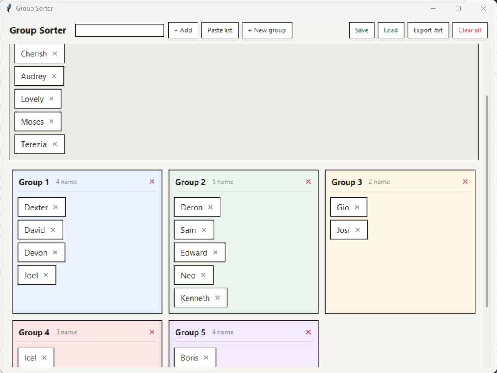

# Group Sorter

A small desktop app for splitting a list of names into groups. Type or paste your names, then drag each one into the group it belongs to.

**[Project page](https://cloudbv.github.io/group_sorter_manual/)** · **[Download on itch.io](https://cloudbv.itch.io/group-sorter-manual)**



## What it does

Group Sorter is for dividing people into teams, tables, or sections when you want to place each person by hand instead of using a random shuffle.

Every name starts in the Unassigned pool. Create as many groups as you need, drag names into them, and move them around until the grouping looks right. Then export the result as a text file or save the session to continue later.

## Features

- **Drag and drop:** drop a name on any group, or back on the pool to unassign it
- **Add names your way:** type one and press Enter, or use **Paste list** to add many from your clipboard (one per line or tab-separated, duplicates skipped)
- **Unlimited groups:** each new group gets its own pastel colour
- **Quick renaming:** double-click a name or a group title to edit it
- **Save and load:** keep your whole session as a `.json` file
- **Export to text:** get a readable `.txt` summary with a timestamp, each group's members, and anyone unassigned

## Run it

Group Sorter uses only Python's standard library. You need Python 3 with tkinter, which is included with the standard Python installers for Windows and macOS.

```bash
git clone https://github.com/cloudBV/group_sorter_manual.git
cd group_sorter_manual
python group_sorter.py
```

Prefer not to use Python? Grab the packaged download from [itch.io](https://cloudbv.itch.io/group-sorter-manual).

## Using the app

| To do this | Do this |
| --- | --- |
| Add one name | Type it in the box and press Enter or click **+ Add** |
| Add many names | Copy a list, then click **Paste list** |
| Create a group | Click **+ New group** |
| Move a name | Drag it onto a group, or onto the Unassigned pool |
| Edit a name or group title | Double-click it, then Enter to confirm or Esc to cancel |
| Remove a name or group | Click the ✕ beside it (a removed group's names return to the pool) |
| Keep your work | **Save** and **Load** use `.json`; **Export .txt** makes a plain-text report |

## Built with

Python 3 and tkinter, in a single script file. No third-party packages.

## Links

- Project page: https://cloudbv.github.io/group_sorter_manual/
- itch.io: https://cloudbv.itch.io/group-sorter-manual
